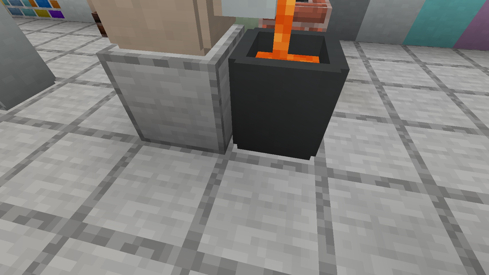
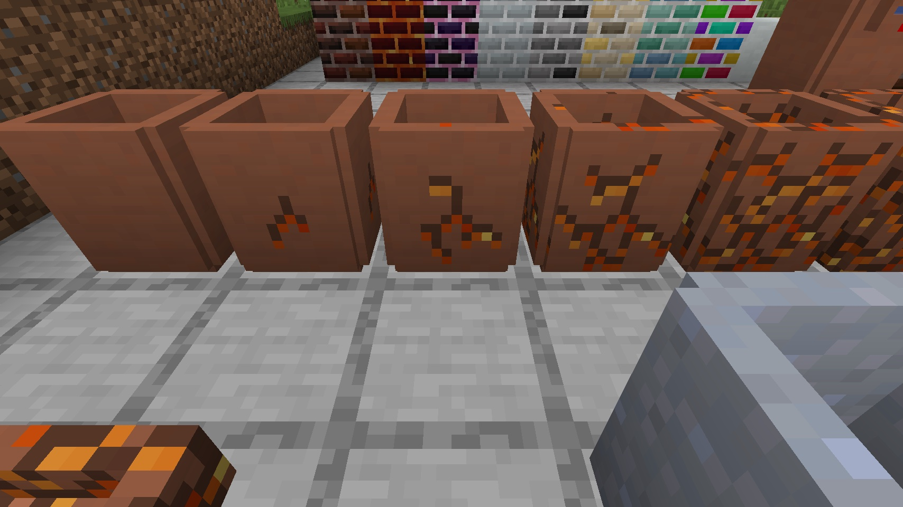
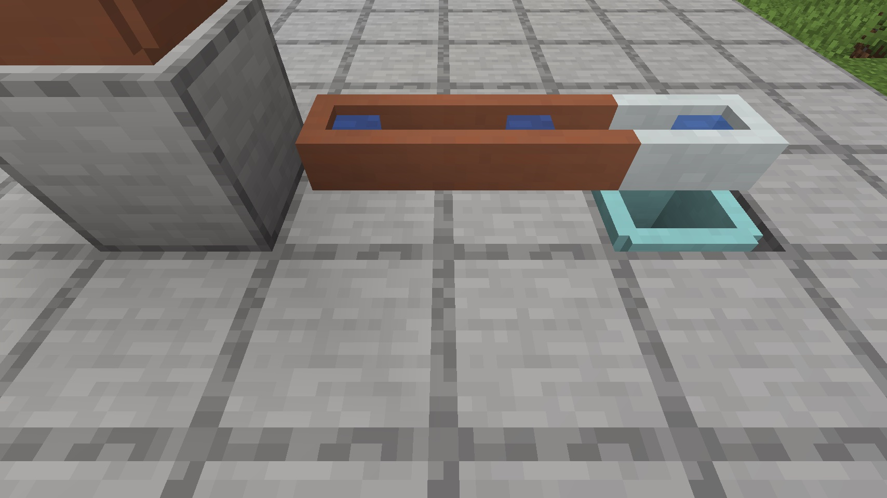
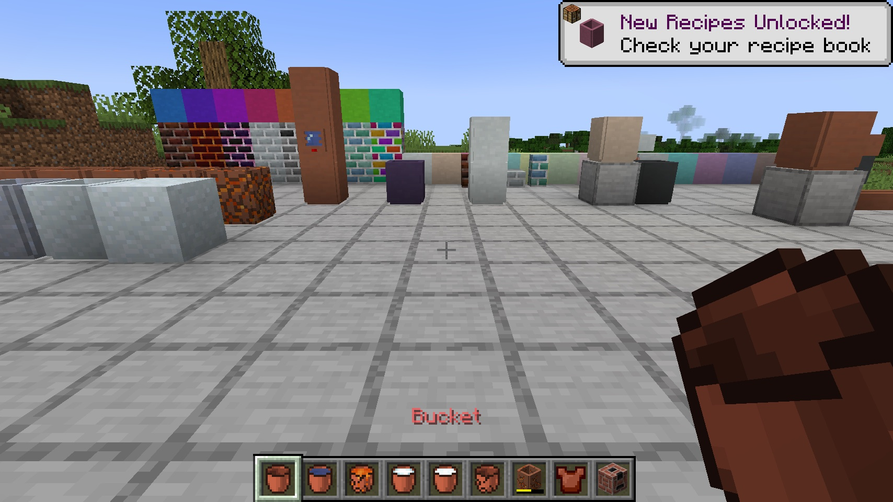
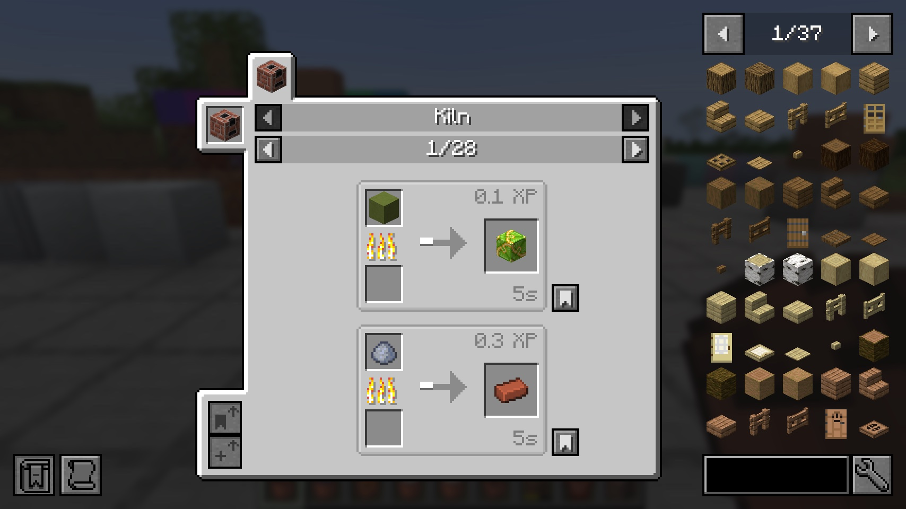
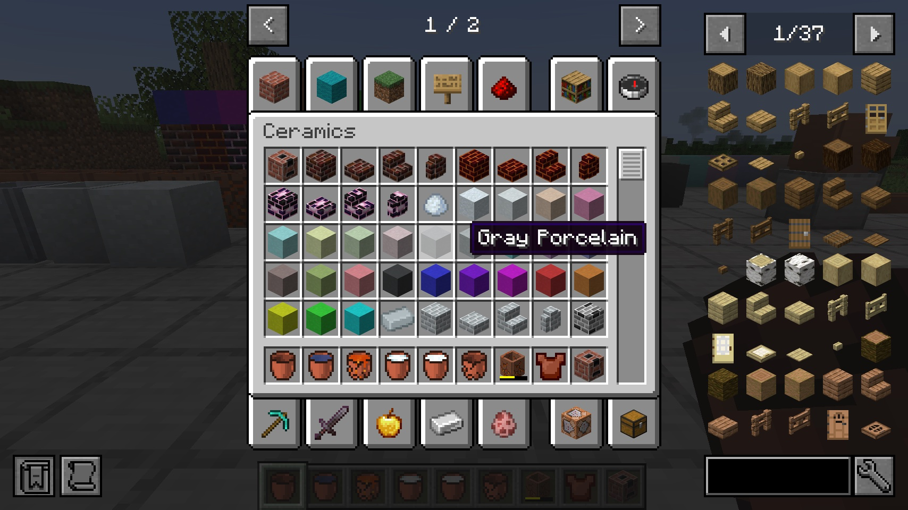

# Ceramics — NeoForge 1.21.1

**Clay buckets, cisterns, faucets, channels, kilns and porcelain — now on Minecraft 1.21.1.**

An unofficial port of **[Ceramics](https://www.curseforge.com/minecraft/mc-mods/ceramics)** 1.8.0 by **KnightMiner**
from Minecraft 1.20.1 (Forge) to **NeoForge 1.21.1**, with all of its content.

<b>🇬🇧 English — click to open</b>

## Download

| Version | Minecraft | Loader | Java |
| --- | --- | --- | --- |
| 1.8.0+1.21.1 | 1.21.1 | NeoForge 21.1.197 or newer | 21 |

Releases: [GitHub releases](../../releases).

## Installation

- **Singleplayer:** put the jar into `mods/` of a NeoForge 1.21.1 instance.
- **Server:** put the same jar into `mods/` of the server **and** of every client.
- **Mantle is included.** Ceramics needs the library Mantle by SlimeKnights, and Mantle for 1.21.1 has no public
  release yet, so it ships inside the jar. If another mod brings a newer Mantle, NeoForge uses the newer one.
- [JEI](https://www.curseforge.com/minecraft/mc-mods/jei) is optional: it shows the kiln recipes.

## Features

- **Clay buckets:** an early-game bucket made of clay. Water, milk, powder snow and every modded fluid; hot fluids such
  as lava crack the bucket and it breaks when emptied.
- **Fluid handling:** cisterns (stack them to grow the capacity), faucets that pour from a tank into the block below,
  channels that carry fluid sideways and down, gauges that show the fluid level.
- **Terracotta and porcelain:** terracotta cisterns, faucets and channels slowly crack while they hold hot fluid
  (repair them with clay), porcelain ones are heat resistant.
- **Kiln:** a furnace for clay, bricks, terracotta and porcelain that fires twice as fast as a furnace.
- **Decoration:** porcelain in 16 colors, rainbow porcelain, dark, lava, dragon, porcelain, monochrome, golden, marine
  and rainbow bricks with stairs, slabs and walls.
- **Clay armor:** a cheap early armor made of fired clay plates.
- **Languages:** English, Russian, Ukrainian, German, Spanish, Brazilian Portuguese, plus Czech, Korean, Turkish and
  Chinese (simplified and traditional) from the original. Ukrainian, German, Spanish and Portuguese are machine
  translations, corrections are welcome.

## What this port fixes

| Problem | In the original |
| --- | --- |
| Kiln recipes did not show in JEI | 1.8.0 |
| Milk clay buckets could be filled by pipes and tanks but not drained | [#88](https://github.com/KnightMiner/Ceramics/pull/88) |
| The creative tab listed the empty bucket twice and no powder snow or unfired buckets | 1.8.0 |
| The cracked empty bucket showed a raw name (`item.ceramics.cracked_empty_clay_bucket`) | 1.8.0 |
| The hidden recipe book button of the kiln could still be clicked | 1.8.0 |
| `/setblock` made a broken cistern (error spam) or a channel that would not flow down | 1.8.0 |
| Wrong durability bar color on cracked cisterns, faucets and channels | 1.8.0 |
| A Russian typo; Czech translation and Korean updates from pull requests that were never merged | [#87](https://github.com/KnightMiner/Ceramics/pull/87), [#84](https://github.com/KnightMiner/Ceramics/pull/84) |

Found during the port and fixed: fluids in cisterns, faucets and channels drew a piece of the texture atlas
(a bug of Mantle 1.21.1, Ceramics renders them itself now), and golden bricks could be mined with a wooden pickaxe.

**Worlds from 1.20.1:** clay buckets keep their fluid or block and cracked blocks keep their cracks when the world is
opened in 1.21.1.

Details for each problem: [PORTLOG.md](PORTLOG.md).

## Testing

- Functional test on a dev server, 44 checks: recipes, buckets, cauldrons, a cistern tower that is broken in the middle
  and merged back, faucets, channels, cracking with lava, drops, saving, data from 1.20.
- Client scene with screenshots (above): fluid rendering, crack stages, bucket models, creative tab, JEI.
- The release jar started on real NeoForge 21.1.259 and 21.1.197 servers with a clean log.

## Reporting problems

Problems of this port go to the [issues of this repository](../../issues), not to KnightMiner.

## Credits and license

- **Ceramics** by [KnightMiner](https://github.com/KnightMiner/Ceramics), MIT
  ([licenses/LICENSE-MIT](licenses/LICENSE-MIT)).
- **Mantle** by [SlimeKnights](https://github.com/SlimeKnights/Mantle), MIT, included in the jar
  ([licenses/LICENSE-MANTLE](licenses/LICENSE-MANTLE)).
- Czech translation: RomanPlayer22. Korean: mindy15963 and the original translators.
- Port to NeoForge 1.21.1: Vladeezyy.

This port is released under **LGPL-3.0-only** ([LICENSE](LICENSE), with the GPL text in
[licenses/COPYING](licenses/COPYING)), Copyright (c) 2026 Vladeezyy. Forks are welcome: they stay open, under the
same license, with credit to the authors. Please download the mod only from the official pages of this project.

<b>🇷🇺 Русский — нажмите, чтобы открыть</b>

## Скачать

| Версия | Minecraft | Загрузчик | Java |
| --- | --- | --- | --- |
| 1.8.0+1.21.1 | 1.21.1 | NeoForge 21.1.197 или новее | 21 |

Релизы: [GitHub releases](../../releases).

## Установка

- **Одиночная игра:** положите jar в папку `mods/` сборки NeoForge 1.21.1.
- **Сервер:** тот же jar кладётся в `mods/` сервера **и** каждого клиента.
- **Mantle уже внутри.** Ceramics нужна библиотека Mantle от SlimeKnights, а у Mantle для 1.21.1 пока нет публичного
  релиза, поэтому она встроена в jar. Если другой мод принесёт более новый Mantle, NeoForge возьмёт его.
- [JEI](https://www.curseforge.com/minecraft/mc-mods/jei) по желанию: в нём видны рецепты печи для обжига.

## Возможности

- **Глиняные вёдра:** ведро для начала игры. Вода, молоко, рыхлый снег и жидкости других модов; горячие жидкости вроде
  лавы трескают ведро, и при выливании оно разбивается.
- **Работа с жидкостями:** бочки (ставьте друг на друга, чтобы увеличить объём), краны, переливающие из резервуара в
  блок ниже, жёлоба, переносящие жидкость в стороны и вниз, датчики уровня жидкости.
- **Терракота и фарфор:** терракотовые бочки, краны и жёлоба постепенно трескаются от горячей жидкости (чинятся
  глиной), фарфоровые жаростойкие.
- **Печь для обжига:** обжигает глину, кирпичи, терракоту и фарфор вдвое быстрее обычной печи.
- **Декор:** фарфор 16 цветов, радужный фарфор, тёмные, лавовые, драконьи, фарфоровые, монохромные, золотые, морские и
  радужные кирпичи со ступеньками, плитами и оградами.
- **Глиняная броня:** дешёвая броня из обожжённых пластин.
- **Языки:** английский, русский, украинский, немецкий, испанский, бразильский португальский, а также чешский,
  корейский, турецкий и китайский (упрощённый и традиционный) из оригинала. Украинский, немецкий, испанский и
  португальский — машинный перевод, исправления приветствуются.

## Что исправлено в порте

| Проблема | В оригинале |
| --- | --- |
| Рецепты печи для обжига не показывались в JEI | 1.8.0 |
| Глиняное ведро с молоком можно было наполнить трубами и резервуарами, но нельзя слить | [#88](https://github.com/KnightMiner/Ceramics/pull/88) |
| В творческой вкладке пустое ведро дважды, а вёдер с рыхлым снегом и необожжённого нет | 1.8.0 |
| Треснувшее пустое ведро показывало сырое название (`item.ceramics.cracked_empty_clay_bucket`) | 1.8.0 |
| Скрытая кнопка книги рецептов в печи для обжига всё ещё нажималась | 1.8.0 |
| `/setblock` ставил сломанную бочку (спам ошибками) или жёлоб, не сливающий вниз | 1.8.0 |
| Неверный цвет полоски прочности у треснувших бочек, кранов и жёлобов | 1.8.0 |
| Опечатка в русском; чешский перевод и обновление корейского из так и не принятых pull request | [#87](https://github.com/KnightMiner/Ceramics/pull/87), [#84](https://github.com/KnightMiner/Ceramics/pull/84) |

Найдено при порте и исправлено: жидкости в бочках, кранах и жёлобах рисовались куском атласа текстур (баг Mantle
1.21.1, теперь Ceramics рисует их сам), а золотые кирпичи добывались деревянной киркой.

**Миры из 1.20.1:** глиняные вёдра сохраняют жидкость или блок, а треснувшие блоки — трещины при открытии мира в
1.21.1.

Подробно по каждой проблеме: [PORTLOG.md](PORTLOG.md).

## Тестирование

- Функциональный тест на dev-сервере, 44 проверки: рецепты, вёдра, котлы, башня из бочек, которую ломают посередине и
  собирают обратно, краны, жёлоба, растрескивание от лавы, дроп, сохранение, данные из 1.20.
- Клиентская сцена со скриншотами (выше): рендер жидкостей, стадии трещин, модели вёдер, творческая вкладка, JEI.
- Релизный jar запущен на настоящих серверах NeoForge 21.1.259 и 21.1.197, лог чистый.

## Сообщить о проблеме

О проблемах этого порта пишите в [issues этого репозитория](../../issues), а не KnightMiner.

## Авторы и лицензия

- **Ceramics** — [KnightMiner](https://github.com/KnightMiner/Ceramics), MIT ([licenses/LICENSE-MIT](licenses/LICENSE-MIT)).
- **Mantle** — [SlimeKnights](https://github.com/SlimeKnights/Mantle), MIT, встроена в jar
  ([licenses/LICENSE-MANTLE](licenses/LICENSE-MANTLE)).
- Чешский перевод: RomanPlayer22. Корейский: mindy15963 и переводчики оригинала.
- Порт на NeoForge 1.21.1: Vladeezyy.

Порт распространяется под **LGPL-3.0-only** ([LICENSE](LICENSE), текст GPL в [licenses/COPYING](licenses/COPYING)),
Copyright (c) 2026 Vladeezyy. Форки приветствуются: они остаются открытыми, под той же лицензией и с указанием
авторов. Пожалуйста, скачивайте мод только с официальных страниц проекта.

